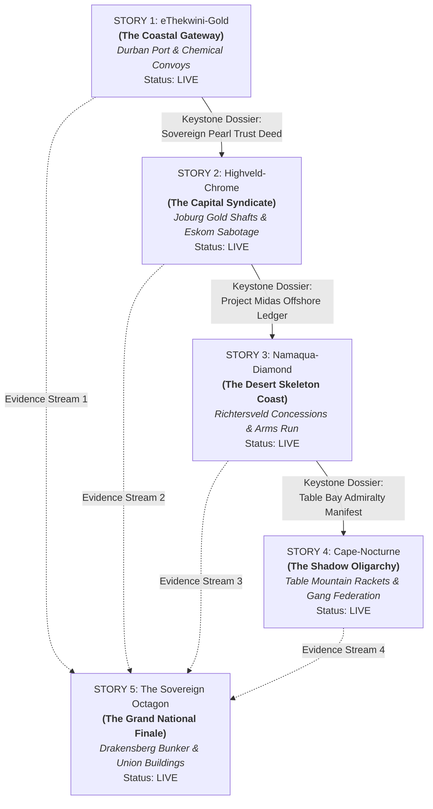

# Mzansi Midnight: The South African State Capture Noir RPG

> *"A country where the power cuts out at 20:00, the water runs dry by Tuesday, and the bank accounts in Dubai fill up by midnight. Every province has its own poison, but they all drink from the same cup."*

[](https://nextjs.org/)
[](https://react.dev/)
[](https://www.typescriptlang.org/)
[](https://vitest.dev/)
[](data/i18n)

**Mzansi Midnight** is an episodic, connected **5-part Dice-and-Node Noir RPG anthology** inspired by *Citizen Sleeper* and *Disco Elysium*. It maps the systemic anatomy of South African state capture, resource cartels, and political conspiracy across five regional crucibles.

---

## 🎲 The 5-Part Campaign Anthology

The quintet spans the geopolitical fractures of South Africa. Each story features its own **regional hub**, **protagonist archetype**, **interactive district map**, **segmented threat clocks**, and **faction dynamics**. Each chapter unlocks sequentially through Keystone Dossier extraction, culminating in a national convergence on the Union Buildings:



### The Chapters
1. **Story 1: eThekwini-Gold** (*The Coastal Gateway*) — A suspended Hawks Warrant Officer probes Docket #409: a R400 million municipal water-tanker tender used to traffic chemical precursors through Pier 2.
2. **Story 2: Highveld-Chrome** (*The Capital Syndicate*) — A disgraced SIU auditor penetrates Eskom coal sabotage syndicates, Sandton energy arbitrageurs, and Witwatersrand *zama-zama* gold reefs.
3. **Story 3: Namaqua-Diamond** (*The Desert Skeleton Coast*) — Maritime border enforcement divers confront offshore diamond-dredging cartels and mercenary arms runs across the Richtersveld.
4. **Story 4: Cape-Nocturne** (*The Shadow Oligarchy*) — Former Anti-Gang Unit detectives take on the tripartite alliance of top police commissioners, Cape Flats gang federations, and historic Winelands oligarchs.
5. **Story 5: The Sovereign Octagon** (*The Grand National Finale*) — Evidence and survivor networks converge on a central conspiracy board in Pretoria to determine the Republic's fate.

---

## ⚡ Core Gameplay Mechanics

- **Daily Action Dice & Composure Engine**: Each Cycle (Day), roll 3 to 5 d6 dice based on your Composure percentage (`80–100%` = 5 dice, `40–79%` = 4 dice, `<40%` = 3 dice).
- **Deterministic Outcome Tiers**:
  - `6+`: **Clean Success** (+2 clock progress, maximum rewards, zero trace).
  - `4–5`: **Compromised Success** (+1 clock progress, minor Composure or Heat penalty).
  - `1–3`: **Failure / Blowback** (Composure damage, precinct heat, or threat clock acceleration).
- **Four Core Investigator Stats (`-1` to `+3+`)**:
  - `street`: Physical intimidation, taxi rank politics, surviving ambushes, raw force.
  - `dockets`: Forensic accounting, municipal registry audits, certified court records.
  - `wire`: Signals intelligence, biometric lock bypassing, radio transponder interception.
  - `influence`: Inside game, bribing magistrates, leveraging political blackmail.
- **Rolling Blackouts (Eskom Load Shedding Grid)**:
  - Rotates between Stages `2 -> 4 -> 6 -> 2` each cycle.
  - **Stage 6 Lockouts**: Forensic servers and cyber pawn terminals lose power unless you burn **Backup Generator Diesel** or activate grid override perks.
  - **Stage 6 Cover**: Infiltration and stealth operations receive a `+2` roll modifier in darkness.
- **SAPS Roadblocks & Hostile Turf**:
  - High heat locks down transit corridors, demanding cold drink bribes or detour dice burns.
  - Factions hostile to you (`Rep <= -2`) impose a `-1` turf roll penalty.
- **Procedural Soundscape**:
  - Zero-dependency Web Audio synthesizer generating filtered coastal rain, 55Hz Eskom transformer hum that shifts pitch during Stage 6 blackouts, dice roll physics, and alert stings.
- **Interactive Conspiracy Board**:
  - Forensic red-string corkboard dynamically tracking suspects, shell trusts, bank records, and keystone dossiers.

---

## 🌍 Multilingual Localization (10 Official South African Languages)

*Mzansi Midnight* is localized across **10 official South African languages** with deep cultural nuance:

| Code | Language | Code | Language |
| :--- | :--- | :--- | :--- |
| `en` | English (Master Source) | `nso` | Sepedi (Northern Sotho) |
| `zu` | isiZulu | `tn` | Setswana |
| `xh` | isiXhosa | `ts` | Xitsonga |
| `af` | Afrikaans | `ss` | Siswati |
| `st` | Sesotho | `ve` | Tshivenḓa |

Includes dynamic reverse mapping, retrospective narrative log translation, and real-time dialect adaptation for tactical advice and dialogue.

---

## 🛠️ Tech Stack & Architecture

- **Frontend**: [Next.js 15 (App Router)](https://nextjs.org/), [React 19](https://react.dev/), [TailwindCSS](https://tailwindcss.com/)
- **State & Logic**: Pure deterministic functional engines (`engine/resolver.ts`, `engine/eventResolver.ts`, `engine/advisor.ts`)
- **Audio Engine**: Web Audio API (`engine/soundscape.ts`)
- **Testing**: [Vitest](https://vitest.dev/) (107 unit tests verifying roll math, clock triggers, campaign state transitions, and i18n dictionaries)
- **Persistence**: Multi-slot local storage manager with auto-migration, case ending archives, and Progressive Web App (PWA) offline support.

---

## 🚀 Getting Started

### Prerequisites
- Node.js 18+ or 20+
- npm, pnpm, or yarn

### Installation
```bash
# Clone the repository
git clone https://github.com/MisterSeitz/mzansi-midnight.git
cd mzansi-midnight

# Install dependencies
npm install

# Start local development server
npm run dev
```

Visit [http://localhost:3000](http://localhost:3000) in your browser.

### Running Tests & Linting
```bash
# Run unit test suites
npm test

# Run TypeScript compiler checks
npx tsc --noEmit

# Build production bundle
npm run build
```

---

## 📁 Repository Structure

```
├── app/                  # Next.js 15 App router & layouts
├── components/           # UI components (Map, Dashboard, Conspiracy Board, Modals)
├── data/                 # Game data, story states, item catalogs, event decks
│   └── i18n/             # 10 official South African language translation dictionaries
├── docs/                 # Architectural blueprints & translation guidelines
├── engine/               # Pure functional game engine, state resolvers & soundscape
│   └── __tests__/        # Automated Vitest test suites (107 tests)
├── public/               # Static assets, graphic novel illustrations & PWA manifest
├── scripts/              # I18n generators, asset generation & translation scripts
└── types/                # TypeScript interfaces and game engine types
```

---

## 📄 License

Proprietary / All Rights Reserved. Created by **MisterSeitz**.
