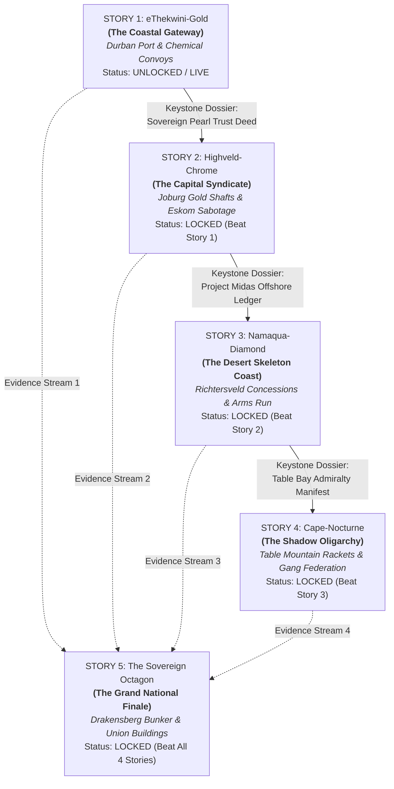

# The Mzansi Midnight Quintet — Story Bible & Narrative Architecture

> *"A country where the power cuts out at 20:00, the water runs dry by Tuesday, and the bank accounts in Dubai fill up by midnight. Every province has its own poison, but they all drink from the same cup."*

---

## 1. Executive Summary & Narrative Concept

**Mzansi Midnight** is structured as a **connected 5-part noir anthology** exploring the systemic anatomy of South African state capture, organized crime, resource warfare, and political intrigue. 

Each story is set in a distinct geographical, industrial, and sociological crucible of South Africa. Each story features its own **protagonist**, **4-stat investigator profile**, **regional map & mechanics**, **local factions**, **segmented clocks**, and **interactive branching dialogues**. 

Crucially, **each story is locked until the player unlocks the preceding story** by achieving a viable campaign ending. As players complete each chapter, they extract a **Classified Keystone Intel Dossier** that unlocks the next regional campaign. In the **Grand Finale (Story 5: *The Sovereign Octagon*)**, the evidence, survivors, and geopolitical threads from all four regional crucible campaigns converge on an epic **National Conspiracy Board** to determine the ultimate fate of the Republic of South Africa.



---

## 2. Story 1: *eThekwini-Gold* (The Coastal Gateway)

| Parameter | Specification |
| :--- | :--- |
| **Status** | **Completed & Live** (Act 1 CBD/Waterfront + Act 2 Umhlanga Ridge/Midlands) |
| **Setting** | eThekwini (Durban), KwaZulu-Natal — Subtropical container terminals, humid CBD neon arcades, Queen Street taxi ranks, Umhlanga glass towers, and Midlands citrus estates. |
| **Protagonist** | **The Suspended Hawks Warrant Officer** (Choose: *The Paper-Trail Auditor*, *The Burned Enforcer*, or *The Ghost Wiretapper*). |
| **Core Conspiracy** | **Docket #409**: A R400 million municipal water-tanker tender used as an off-the-books logistics cover to smuggle 20,000 litres of pharmaceutical chemical precursors from Pier 2 to illicit methamphetamine super-labs in the Midlands. |
| **Primary Antagonist** | **Zuko "The Architect" Ndlovu** (Abasanta Logistics) & **Brigadier Titus Mokoena** (SAPS Tactical Response Team). |
| **Core Factions** | `abasanta` (Port Cartel), `city_hall` (Tender Mafia), `saps_trt` (Rogue Tactical Police), `street_syndicate` (Queen St Taxi Alliance), `hawks` (DPCI Archive Holdouts). |
| **Regional Mechanic** | **Rolling Stage 6 Blackouts & Generator Overrides**: Certain forensic and server action slots lose power during Stage 6 unless diesel is purchased; nighttime port infiltration slots receive a `+2` stealth bonus during blackouts. |
| **Keystone Extraction** | **The Sovereign Pearl Trust Deed & Hangar 7 Charter Intercept**: Reveals that the hundreds of millions laundered through Durban's water tenders were wired directly into Highveld coal-procurement fronts and offshore shell companies operating out of Sandton. |
| **Unlock Reward** | Unlocks **Story 2: *Highveld-Chrome*** in the Campaign Selector, plus the **Hawks National Security Clearance Badge**. |

---

## 3. Story 2: *Highveld-Chrome* (The Capital Syndicate)

| Parameter | Specification |
| :--- | :--- |
| **Status** | **Next in Pipeline** (Story Pack 2) |
| **Setting** | Johannesburg & Pretoria (Gauteng) — The brutalist concrete ridges of Hillbrow, Sandton corporate glass monoliths, the Union Buildings security precinct, abandoned Witwatersrand gold mine shafts (*zama-zamas*), and the coal-fired power stations of the Mpumalanga border. |
| **Protagonist** | **Kagiso "Bra K" Molefe** — A disgraced Special Investigating Unit (SIU) forensic auditor turned private corporate intelligence operative whose whistleblower sister was assassinated on the M1 highway. |
| **Core Conspiracy** | **The Megawatt Sabotage & Coal Cartel**: Strategic destruction of Eskom power station conveyor belts, transformer bombing, and deliberate coal-grade dilution engineered to force billions in emergency open-cycle gas turbine diesel contracts, managed by private security oligarchs and corrupt cabinet insiders. |
| **Primary Antagonist** | **General Sibusiso "The Bull" Sithole** (National Intelligence Agency / Private Security Oligarch) & **Helena Van Niekerk** (Sandton Energy Arbitrage Consortium). |
| **Core Factions** | 1. **The Megawatt Cartel** (Coal trucking syndicates & corrupt station managers)<br/>2. **Sandton Corporate Arbitrage** (Private energy traders & offshore bankers)<br/>3. **The Reef Zama-Zamas** (Illegal gold mining cooperatives in deep abandoned shafts)<br/>4. **SIU Clean Hands** (Underground anti-corruption prosecutors)<br/>5. **The Red Guard Populists** (Radical township strike marshals). |
| **Regional Mechanic** | **Grid Overload & Deep Mine Infiltration**: Players must balance local Substation Load Shedding with **Mine Shaft Gas Levels** (requiring rebreathers or bribes to surface miners). Action slots in abandoned gold reefs offer immense cash but advance the *Rockfall Hazard Clock*. |
| **Keystone Extraction** | **Project Midas Offshore Ledger & Cahora Bassa Decryption Key**: Proves that the diesel sabotage profits are being converted into uncut industrial diamonds through the desolate desert ports of the Northern Cape to fund arms shipments. |
| **Unlock Reward** | Unlocks **Story 3: *Namaqua-Diamond***, plus the **SIU Encrypted Cold-Storage Ledger**. |

---

## 4. Story 3: *Namaqua-Diamond* (The Desert Skeleton Coast)

| Parameter | Specification |
| :--- | :--- |
| **Status** | **Planned** (Story Pack 3) |
| **Setting** | Port Nolloth, Alexander Bay, and the Richtersveld Desert (Northern Cape) — The stark, wind-swept Atlantic Skeleton Coast, fog-shrouded diamond-dredging bakkies, De Beers ghost concession towns, cross-border desert landing strips along the Orange River, and Namibian border crossings. |
| **Protagonist** | **Captain Gideon "Giepie" Brand** — A battle-hardened ex-maritime border enforcement diver and desert tracker living off salvage scrap, holding a personal grudge against private military contractors. |
| **Core Conspiracy** | **Operation Deep-Gravel**: Illegal seabed diamond-dredging concessions, cross-border arms drops, and military-grade radar surveillance run by an ex-mercenary private naval security firm (*Aegis-Atlantis*). Black money from eThekwini chemical runs and Highveld power contracts is laundered through unregistered rough diamonds traded to international conflict brokers. |
| **Primary Antagonist** | **Colonel Yuri Petrov** (Ex-Wagner / Maritime Smuggling Broker) & **Dirk "Oom Dirk" Coetzee** (Concession Baron & Former Coast Guard Chief). |
| **Core Factions** | 1. **Aegis-Atlantis Marine Security** (Heavily armed private naval mercenaries)<br/>2. **The Artisanal Shore Divers** (Impoverished local divers risking the bends for rough stones)<br/>3. **The Cross-Border Kalahari Runners** (Desert 4x4 bakkie convoys crossing into Namibia)<br/>4. **Namaqua Coastal Command** (Underfunded, incorruptible local SAPS & Sea Fisheries holdouts)<br/>5. **The Namib Diamond Syndicate** (Offshore international buyers operating from yacht charters). |
| **Regional Mechanic** | **Coastal Fog (The Malmokken) & Fuel Scarcity**: Dense coastal sea fog grants `+2` infiltration bonuses to coastal nodes but locks out long-distance desert road travel unless the player manages **Diesel Jerrycans** (`fuel` resource). |
| **Keystone Extraction** | **Table Bay Admiralty Manifest & Red Mercury Bill of Lading**: Documents a clandestine maritime transfer of Cold War tactical armaments and biometric ciphers shipped south toward Table Bay Harbour. |
| **Unlock Reward** | Unlocks **Story 4: *Cape-Nocturne***, plus the **Namaqua High-Frequency Radio Transponder**. |

---

## 5. Story 4: *Cape-Nocturne* (The Shadow Oligarchy)

| Parameter | Specification |
| :--- | :--- |
| **Status** | **Planned** (Story Pack 4) |
| **Setting** | Cape Town & The Winelands (Western Cape) — Glitzy Camps Bay Atlantic Seaboard strip, Long Street neon nightlife, gang-controlled tenement blocks in Manenberg and Mitchells Plain, Table Bay container docks, and centuries-old Stellenbosch wine estates hiding offshore wealth trusts. |
| **Protagonist** | **Leila Hendricks** — A sharp, cynical former Anti-Gang Unit (AGU) detective turned private investigator whose partner was framed by high-ranking police generals and murdered during a gang raid. |
| **Core Conspiracy** | **The Night-Economy Extortion Federation & The Table Bay Arms Pipeline**: A tripartite syndicate consisting of top provincial police generals, unified Cape Flats gang cartels, and historic Winelands oligarchs who control the nightclub security extortion rackets, drug distribution networks, and container docks. The stolen naval armaments from Namaqualand are slated to arm a private shadow army. |
| **Primary Antagonist** | **Major-General Andre "The Ghost" Swart** (Provincial Police Commissioner) & **Jerome "King" Solomons** (The Firm / Cape Flats Gang Boss). |
| **Core Factions** | 1. **The Long Street Security Racket** (Bouncers, extortion rings, nightclub kingpins)<br/>2. **The 28s / Cape Flats Federation** (Ruthless prison gang network controlling street narcotics)<br/>3. **The Winelands Capital Club** (Centuries-old family dynasties laundering cash through viticulture)<br/>4. **AGU Renegades** (Underground rogue cops waging an unsanctioned guerrilla war on gangs)<br/>5. **The Harbour Stevedores Union** (Port dockers fighting container contraband). |
| **Regional Mechanic** | **Gang Warfare Turf Shift & Mountain Sea-Mist**: District danger shifts dynamically as gang wars erupt across nodes. When gang tension hits `6/6`, transit requires spending dice on evasion or paying the *Toll*. Wine estate nodes offer safe havens but demand high **Influence** stat checks. |
| **Keystone Extraction** | **The Grand Sovereign Protocol (The Red Cipher)**: The ultimate classified master blueprint connecting the Durban chemical pipeline, the Highveld grid sabotage, the Namaqua diamond-arms corridor, and the Cape protection army directly to a central cabal known as **"The Sovereign Octagon"**. |
| **Unlock Reward** | Unlocks **Story 5: *Mzansi Midnight: The Sovereign Octagon***, plus the **Master Octagon Decryption Key**. |

---

## 6. Story 5: *Mzansi Midnight: The Sovereign Octagon* (The Grand National Finale)

| Parameter | Specification |
| :--- | :--- |
| **Status** | **Planned** (Grand Culmination Campaign) |
| **Setting** | Multi-Theatre National Climax — A decommissioned subterranean Cold War bunker beneath the Drakensberg mountains, executive jet airspace over the Karoo, the sub-basements of the Union Buildings in Pretoria, and the command center of the national electrical grid. |
| **Protagonist** | **The United Hawks Taskforce**: The player assembles a strike team featuring the surviving protagonists from the previous 4 chapters (The Hawks Auditor, Bra K, Captain Brand, and Leila Hendricks), allocating them across simultaneous tactical fronts. |
| **Core Conspiracy** | **Operation Midnight Sun**: The 8 puppet masters behind the regional syndicates—corrupt ministers, police generals, port oligarchs, and private military bosses—have triggered a nationwide **Black-Sky Grid Collapse** (total Stage 8 blackout), panic-buying of state enterprises, and a quiet military coup to establish an authoritarian corporate oligarchy. |
| **Primary Antagonist** | **The Sovereign Octagon**: The 8 named conspirators, uncovered across all 4 previous stories, gathered in a fortified summit to execute their final transfer of South African sovereignty. |
| **Core Factions** | The player must leverage the faction reputation, allies, and specialized gear unlocked across all 4 previous campaigns: Hawks Holdouts, Taxi Alliances, Clean Prosecutors, Desert Divers, and Port Stevedores against the Unified Sovereign Security Force. |
| **Regional Mechanic** | **The National Grid Countdown & Multi-Front Operational Board**: The clock is ticking toward total nationwide power grid collapse (`0/8`). Players must allocate dice across 4 simultaneous regional tactical theaters (Durban Port, Joburg Substation, Atlantic Radar, and Cape Docks) to cut off the Octagon's escape routes and communication nodes before mounting the final raid. |
| **The 5 Grand Endings** | 1. **The Constitutional Reckoning**: Full forensic evidence delivered to an emergency Constitutional Court session; the conspirators are arrested, and state institutions are salvaged.<br/>2. **The People's Revolution**: The files are leaked directly to public broadcasters and union networks; mass civilian uprisings dismantle the tender oligopoly from below.<br/>3. **The Shadow Director**: The player leverages the master cipher to usurp the Octagon, taking control of the shadow state to run South Africa from the dark.<br/>4. **The Balkanized Republic**: The coup is broken, but the national grid collapses completely; South Africa fractures into regional warlord and syndicate territories.<br/>5. **The Vanished Watchers**: The conspirators are eliminated in a covert strike; the evidence is buried in the Drakensberg vault, and the taskforce disappears into the midnight fog. |

---

## 7. Campaign Progression & State Stitching Engine

### 7.1. Progressive Unlock Hierarchy
To maintain dramatic tension, narrative momentum, and systemic depth, campaigns unlock strictly in chronological sequence:

```
[Story 1: eThekwini-Gold]  -- (Completed: Epilogue Achieved)
         │
         ▼
[Story 2: Highveld-Chrome]  -- (Completed: Epilogue Achieved)
         │
         ▼
[Story 3: Namaqua-Diamond] -- (Completed: Epilogue Achieved)
         │
         ▼
[Story 4: Cape-Nocturne]   -- (Completed: Epilogue Achieved)
         │
         ▼
[Story 5: The Sovereign Octagon] -- (Grand Finale Unlocked)
```

### 7.2. Persistent Campaign State Schema
The game persists overarching anthology progress in browser `localStorage` under `mzansi_campaign_progression_v1`:

```typescript
export interface CampaignProgression {
  unlockedStories: Array<'story_1' | 'story_2' | 'story_3' | 'story_4' | 'story_5'>;
  completedStories: Record<string, {
    endingId: string;
    completedAt: string;
    keystoneDossierId: string;
    heroStatCarryover: {
      stat: 'street' | 'dockets' | 'wire' | 'influence';
      bonus: number;
    };
    unlockedFactionFavors: string[];
  }>;
  collectedKeystones: string[]; // ['dossier_sovereign_pearl', 'dossier_project_midas', 'dossier_admiralty_manifest', 'dossier_red_protocol']
  grandConspiracyBoardUnlocked: boolean;
}
```

### 7.3. Cross-Story Legacy Carryover
When transitioning from one story to the next:
1. **Keystone Dossier**: Automatically added to the player's Evidence Inventory in the new campaign, granting unique dialogue options with federal investigators and underworld figures.
2. **Hero Trait Bonus**: Based on the ending chosen in the previous story, the player receives a permanent `+1` stat bonus or special black-market hardware in subsequent campaigns.
3. **National Conspiracy Board Threads**: Evidence pins and suspects collected in prior stories populate the background pins of the Red-String Conspiracy Board, building up toward the massive 5-story web in Story 5.

---

## 8. Localization & Dialect Authenticity Across the 5 Stories

In accordance with [`docs/STORY_TRANSLATION_BLUEPRINT.md`](file:///c:/Users/Faiz/Documents/workspaces/mzansi-midnight/docs/STORY_TRANSLATION_BLUEPRINT.md), every story in the quintet is fully translated across **all 10 official South African regional languages**:
- `en` (English), `zu` (isiZulu), `xh` (isiXhosa), `af` (Afrikaans), `st` (Sesotho), `nso` (Sepedi), `tn` (Setswana), `ts` (Xitsonga), `ss` (Siswati), `ve` (Tshivenḓa).

### Regional Linguistic Flavors by Story
Each story emphasizes authentic local linguistic nuances, slang, and idioms while maintaining complete grammatical rigor across all 10 translations:
- **Story 1 (eThekwini-Gold)**: Coastal isiZulu, Durban English slang (*chommie*, *ou*, *bra*), and port maritime jargon.
- **Story 2 (Highveld-Chrome)**: Urban Tsotsitaal, Sesotho, Sepedi, Setswana, and high-stakes corporate Sandton / Pretoria political terms.
- **Story 3 (Namaqua-Diamond)**: Arid Namaqualand Afrikaans (*die Boesmanland*, *malmokken*, *spoelklippe*), coastal dialect expressions, and diamond diver argot.
- **Story 4 (Cape-Nocturne)**: Cape Flats Afrikaans / Kaaps (*dala*, *nommer*, *kwaai*), isiXhosa township dialects, and Old Cape Winelands colloquialisms.
- **Story 5 (The Sovereign Octagon)**: High-level state intelligence code-words, Cold War cipher terms, and pan-South African dialogue blending all regional vernaculars.

---

## 9. Visual Aesthetic & Soundscape Progression

| Story | Color Palette & Key Visual Motifs | Procedural Soundscape Accent |
| :--- | :--- | :--- |
| **Story 1: eThekwini-Gold** | Amber gold neon, charcoal port tarmac, deep ocean cyan. Container cranes, neon rain, taxi rank queues. | Coastal rain, 55Hz Eskom grid transformer hum, harbour foghorns. |
| **Story 2: Highveld-Chrome** | Industrial rust, electric blue substation arcs, concrete grey. Brutalist towers, mine shaft headgear, winter smog. | Highveld thunderstorm rumbles, high-voltage electrical crackles, mine lift cage clatter. |
| **Story 3: Namaqua-Diamond** | Ochre desert dust, bleached salt white, midnight navy. Barren desert flats, dredging bakkies, rusted iron hulks. | Desert wind howls, dry gravel crunches, Atlantic shore break, mechanical sonar pings. |
| **Story 4: Cape-Nocturne** | Deep wine burgundy, neon emerald green, violet coastal mist. Cape Dutch gables, neon alleyways, Table Mountain silhouette. | South-Easter howling wind (*The Cape Doctor*), distant nightclub bass thumps, ocean surf. |
| **Story 5: The Sovereign Octagon** | Obsidian black, tactical crimson red, stark fluorescent white. Underground concrete blast doors, radar screens, server banks. | Subterranean ventilation drone, emergency klaxons, cryptographic teletype clicks, tactical radio static. |
